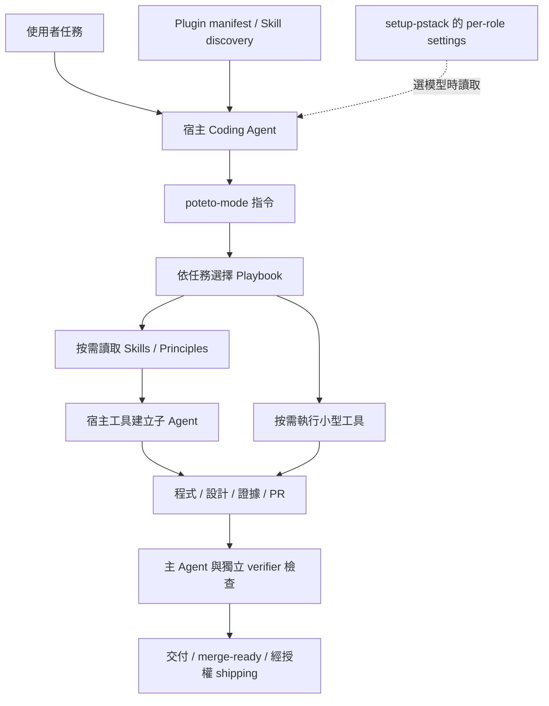
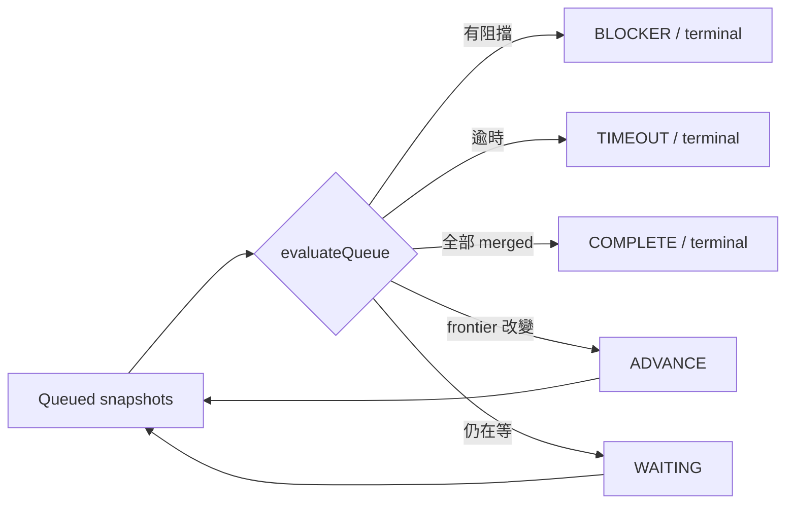

# pstack Research & Discovery

研究日期：2026-11-16（Asia/Taipei）。本交付是 requirement.md 的 Phase 1，尚未進行網站實作。

## 先讀這個結論

pstack 是一組供 AI Coding Agent 使用的工程工作方式、技能文件與工具。使用者交付任務後，宿主 Agent 依照 `poteto-mode` 選擇 Playbook，再讀取需要的 Skills、委派子 Agent、驗證產出。主要協作機制寫在 Markdown；部分檢查才由 TypeScript、JavaScript 或 Shell 實作。**閱讀到工作流規則，不能等同於執行時必定遵守規則。** [poteto-mode](../../pstack/skills/poteto-mode/SKILL.md)、[plugin manifest](../../pstack/.cursor-plugin/plugin.json)。

本機研究對象是 **backnotprop/pstack standalone mirror**，不是上游原作者的獨立 repository。它從 `cursor/plugins/pstack` 同步，另有 harness-neutral 改寫與 community fixes。manifest 標示作者 **Lauren Tan**，README 使用 **poteto**；mirror 維護者與原作者必須分開呈現。 [MIRROR.md](../../pstack/MIRROR.md)、[README](../../pstack/README.md)、[plugin.json](../../pstack/plugin.json)。外部身分交叉查證與分享資料見 [external-sources.md](external-sources.md)。

作者在 README 把目標表述為較少、較高品質的程式碼，並以先深入理解、可驗證的工作支援平行化。這是作者的目標與說明，並非本研究證實的品質或速度提升。 [README 的上游部分](../../pstack/README.md)。

## 閱讀順序

1. 本文件：背景、架構、元件協作、狀態與限制。
2. [components.md](components.md)：58 個頂層 Skills、2 個 Agents、3 個 automation instructions 的完整宣告盤點。
3. [workflows.md](workflows.md)：23 個 Playbooks 與重要組合流程的步驟、分支、驗證和交接。
4. [dependencies.md](dependencies.md)：有證據的直接引用、條件式呼叫與間接路徑。
5. [external-sources.md](external-sources.md)：作者、官方文件、講座與無法查證的來源。
6. [source-snapshot.json](source-snapshot.json)：569 個非 Git 檔案的路徑、大小與 SHA-256。

## 研究範圍與證據規則

本機 commit 為 `74bcc61bd216687b1d6d480c28f109adfc9824ec`，commit 日期 `2026-11-15T12:35:15-05:00`，plugin version `0.15.42`。remote 為 `https://github.com/backnotprop/pstack.git`。本報告不把遠端 main 的後續內容算進本機版本；[SYNC-LOG](../../pstack/SYNC-LOG.md) 是 mirror 的同步紀錄，不能取代上游 commit 的完整比對。

| 標記 | 本研究的判準 | 不代表什麼 |
|---|---|---|
| Verified Implementation | 能從本機特定檔案確認的結構、宣告或程式分支 | 不代表已執行，也不代表 LLM 必定遵循文件 |
| Author's Explanation | 作者本人或專案文件明確說出的意圖、方法 | 不代表已有實驗證明效益 |
| Inference | 由證據延伸的分析，正文會明示 | 不冒充原作者的設計理由 |
| Unknown | 尚無足夠證據，或來源無法完整取得 | 不補寫演講內容或虛構實作 |

Verified Implementation 另區分 **instruction-defined**（Markdown 程序）與 **code-enforced**（可執行程式）。後續 Academy 應同時保留 evidence kind、execution kind、source path、版本，避免把提示詞流程畫成硬性保證。

方法為完整檔案盤點、全部頂層 Skill 的 frontmatter／結構盤點、核心 Skill 全文閱讀、23 個 Playbooks 的流程閱讀、工具入口與關鍵分支追蹤、Benny pack 的設定與操作規範分析，以及第一手外部資料查證。這不是 569 個檔案逐行 code review；大型 statechart fixture corpus 已盤點，未逐一重跑。

## Project Overview

### 真實來源與版本差異

| 層次 | 角色與確認結果 | 證據 |
|---|---|---|
| 上游 | Cursor plugins repository 的 `pstack/`；manifest 作者 Lauren Tan | [plugin.json](../../pstack/plugin.json) |
| Mirror | backnotprop/pstack；`upstream` 分支保留上游、`main` 疊加 mirror 變更 | [MIRROR](../../pstack/MIRROR.md) |
| Mirror 改動 | README 前言、跨 harness 指令；README 列出的 no-comments 外部約束保留與 statechart Windows 修正 | [README](../../pstack/README.md) |
| 目前 checkout | 0.15.42，58 個 Skills，含 24 個 principle Skills，23 個 Playbooks | [可重現盤點](components.md) |

上述 mirror 差異是維護文件的宣告與本機內容；本次未對兩個 repository 的每一行做雙向 diff，不能斷言差異只有 README 列出的項目。歷史同步是否完整亦保留 Unknown。

### 它試圖解決的問題

| 問題 | 實際對應的機制 | 證據類別與來源 |
|---|---|---|
| Agent 沒理解系統就寫程式 | 先 trace subsystem；跨函式設計導向 architect；先選資料形狀 | instruction-defined，[poteto-mode](../../pstack/skills/poteto-mode/SKILL.md) |
| 一次產生大量難以審查的修改 | 分成可驗證單位、小 commits、證據指向實際 artifact | instruction-defined，[sequence-verifiable-units](../../pstack/skills/principle-sequence-verifiable-units/SKILL.md) |
| 把編譯成功或子 Agent 自述當成完成 | 真實 surface 驗證、獨立 verifier、相同 SHA 的判定 | instruction-defined，[prove-it-works](../../pstack/skills/principle-prove-it-works/SKILL.md)、[shipping](../../pstack/skills/poteto-mode/playbooks/shipping.md) |
| 單一方案太早鎖定設計 | arena 多候選、跨 vendor judge、parent 自行閱讀與整合 | instruction-defined，[arena](../../pstack/skills/arena/SKILL.md) |
| 平行工作互相覆寫 | 每個 worker 自己的 worktree／輸出；優先消除共享寫入 | instruction-defined，[swarm](../../pstack/skills/swarm/SKILL.md) |
| 長時間執行失去脈絡或無法稽核 | decision TSV、resume note、transcript 與 Git live state 對照 | instruction-defined＋小型 helper，[show-me-your-work](../../pstack/skills/show-me-your-work/SKILL.md)、[session-pickup](../../pstack/skills/poteto-mode/playbooks/session-pickup.md) |

**Inference：**與「使用單一 coding agent 直接完成任務」這個教學基準比較，pstack 的差異在於把設計探索、委派、驗證與交接寫成可重用程序。這不是對所有其他 Agent Workflow 系統的市場比較，也不是 pstack 獨有能力的證明。

## Architecture Analysis

### 元件與執行邊界

以下是根據檔案關係整理的**概念架構圖**，不是由 runtime trace 自動產生的 call graph。



1. **Discovery 層。** Cursor manifest 明確指向 `./skills/` 與 `./agents/`；一般 `plugin.json` 則有 metadata。`/poteto-mode` 這種入口是宿主對 Skill 的啟用方式，沒有額外 `commands/` 目錄或自建命令 parser 來執行全部 workflows。 [Cursor manifest](../../pstack/.cursor-plugin/plugin.json)。
2. **規範層。** `poteto-mode/SKILL.md` 聚合 triggers、原則、autonomy、subagent 與 harness mappings，底下的 Playbooks 是任務分流。這些路由由讀文件的 Agent 判斷，未找到通用 workflow engine。 [poteto-mode](../../pstack/skills/poteto-mode/SKILL.md)。
3. **委派層。** `poteto-agent` 要求先讀完整 mode；arena、swarm、interrogate 有各自角色與聚合方式。建立程序、上下文容量、工具權限、實際模型供應由宿主提供。 [Agent](../../pstack/agents/poteto-agent.md)、[arena](../../pstack/skills/arena/SKILL.md)。
4. **可執行工具層。** watch-pr 查 GitHub、check-plan 檢查特定計畫格式、statechart 驅動 TLC 與產生圖表、log.sh 寫 TSV、worktree-audit 做盤點。它們各自有狹義職責，並不共同構成一個全域 scheduler。 [工具目錄](components.md)、[source snapshot](source-snapshot.json)。
5. **外部整合層。** GitHub／Origin、Cursor 的 cloud agents／Bugbot／Automations、控制 app 的技能及 tracker 等按流程使用。Benny 依賴實際建立的外部 automations，repository 本身的 pack 是 dormant sources。 [Benny README](../../pstack/automations/benny/README.md)。

### 重要元件的 What / Why / When / How

此處的 Why 若來自文件即為 Author's Explanation；效益仍未量測。每個例子均為**教學情境，未執行 pstack**。

| 元件 | What 與 Why | When／例子 | How、輸入與輸出 | Dependencies／Source |
|---|---|---|---|---|
| poteto-mode | Agent 工作方式與路由；把工程規範帶進任務 | 需要嚴謹完成的任務，例如修正捲動 bug | 讀任務→選 Playbook→套用需要的 Skills；輸入 request／repo，輸出依 Playbook 決定 | [SKILL](../../pstack/skills/poteto-mode/SKILL.md)，引用各 Playbooks、Principles |
| setup-pstack | 設定各角色模型與 reasoning budget | 第一次設定或改預算 | 偵測可用模型→讀舊設定→選 budget／確認角色→驗證→寫完整設定檔 | [SKILL](../../pstack/skills/setup-pstack/SKILL.md)，使用宿主 model list／問答工具 |
| architect | 實作前決定型別、signature、模組邊界 | 涉及函式邊界的設計，例如重設 cache API | grounding→arena 比較至少兩種結構→合成 sketch／rationale→依 sketch 實作；checkpoint 是 opt-in | [SKILL](../../pstack/skills/architect/SKILL.md)、[runner prompt](../../pstack/skills/architect/references/runner-prompt.md)，依 arena／條件式 why |
| arena | 多方案探索與合成；降低單一路徑過早鎖定 | 多種合理實作形狀 | 相同 task／rubric→獨立 candidates→可用時跨 vendor judge→parent 選 base／graft→verify | [SKILL](../../pstack/skills/arena/SKILL.md)，宿主子 Agent、獨立輸出與模型設定 |
| swarm | 平行覆蓋或競賽後彙總 | 多個獨立模組的檢查 | 定義 done／partition 或 race→fan out→檢查 SHA／method→aggregate；回傳 PASS／ISSUES／BLOCKED | [SKILL](../../pstack/skills/swarm/SKILL.md)，不負責 arena 的 base／graft |
| interrogate | 對抗式審查，只留能重現的 finding | 設計有爭議或需要找盲點 | 以 intent 與 diff 為輸入；用 arena fan-out；重跑每個證明；輸出合併後 findings，不實作修正 | [SKILL](../../pstack/skills/interrogate/SKILL.md)，arena 部分階段、in-your-own-words |
| poteto-agent | mode 的委派角色，不是頂層 orchestrator | Playbook 派出 code-writing/helper | parent 傳 mode 絕對路徑與 scope；child 先讀 mode 與適用 principles；輸出依任務 | [定義](../../pstack/agents/poteto-agent.md)，依 poteto-mode；找不到 mode 要回報 |
| no-comments／comment-sicko | 審查註解與應改由結構表達的限制 | review 前，例如 stale workaround 註解 | 指定 scope→reviewer 分析→parent 處理可接受 findings；外部約束不可驗證時保留 REVIEW | [Skill](../../pstack/skills/no-comments/SKILL.md)、[Agent](../../pstack/agents/comment-sicko.md)、[mirror reference](../../pstack/skills/no-comments/references/comment-sicko.md) |
| create／maintain-verification-skill | 產生並維護 repo 專屬驅動／驗證指南 | app 缺少可重現真實使用路徑 | 探查 app→產生 verify skill／feature map→端到端證明；維護時 source wave＋單一 coordinator live pass | [建立](../../pstack/skills/create-verification-skill/SKILL.md)、[維護](../../pstack/skills/maintain-verification-skill/SKILL.md)；實際 driver 依 app |
| create／maintain-formal-verification-skill | 對高風險區域建立有範圍的形式驗證 | race、重試、parser 等 | 選 target／工具／property→對應 code→讓 broken variant 失敗；輸出 verify skill、模型與 coverage／sync commit | [建立](../../pstack/skills/create-formal-verification-skill/SKILL.md)、[維護](../../pstack/skills/maintain-formal-verification-skill/SKILL.md)；TLA+ 時依 statechart |
| statechart | 將 TLA+ 檢查結果轉成可讀路徑與 Mermaid | 已有或準備建立系統模型 | spec／cfg／optional view→TLC→parse／IR／graph passes→report.md、可能有 chart.mmd、tlc.out | [Skill](../../pstack/skills/statechart/SKILL.md)、[pipeline](../../pstack/skills/statechart/scripts/pipeline.ts)、[run](../../pstack/skills/statechart/scripts/run.ts)；TS runtime、mise、Java、TLC |
| show-me-your-work | 長任務決策與證據紀錄 | 無人值守 run／hillclimb | 一個 canonical TSV，逐筆追加；輸入 phase／decision／why／evidence／result；helper 加 timestamp 與 sanitization | [Skill](../../pstack/skills/show-me-your-work/SKILL.md)、[log.sh](../../pstack/skills/show-me-your-work/scripts/log.sh)，不是自動記錄所有工具呼叫 |
| recall／session-pickup | 重建脈絡；前者跨近期相關工作，後者接手一個既有 run | 回到一週前的子系統工作／接替中斷 chat | 限定 workspace／時間→transcript 與 shared record→Git／PR live state→brief 或重新路由 | [recall](../../pstack/skills/recall/SKILL.md)、[pickup](../../pstack/skills/poteto-mode/playbooks/session-pickup.md) |
| Benny pack | Slack report 分類、重現、可選 bounded fix 的 automation 範本 | 團隊想把 issue report 送入處理流程 | setup 複製 pack／配置→外部 trigger 啟動兩個 automations；可信 triage marker 串接，最多 draft PR | [FOR_AGENTS](../../pstack/automations/benny/FOR_AGENTS.md)、[config](../../pstack/automations/benny/templates/configuration.example.yaml) |

## 可執行工具與相依套件

| 工具／入口 | code-enforced 範圍 | 相依與產物 | 重要限制 |
|---|---|---|---|
| [watch-pr](../../pstack/skills/poteto-mode/scripts/watch-pr/watch-pr) | CLI options／GitHub snapshots／阻擋優先序／poll／timeout／verdict | Bun；commander `14.0.0`；GitHub reader 經 `gh`；NDJSON 預設、pretty 選項 | GitHub 專屬；不能據此宣稱 Origin 已受同一工具驗證 |
| [bootstrap.ts](../../pstack/skills/poteto-mode/scripts/bootstrap.ts) | 依 package＋bun.lock hash 判斷是否安裝，frozen install 後重啟 | 寫 scripts/node_modules 與 install key | 首次執行可能安裝套件，研究時未執行 |
| [check-plan.mjs](../../pstack/skills/poteto-mode/scripts/check-plan.mjs) | 檢查 multi-phase-plan 的 headings、markers、boxes、部分文字格式 | Node、計畫 Markdown；錯誤行號／exit code | 只驗證格式與規範元素，不證明計畫正確或十個 lanes 已跑 |
| [worktree-audit.sh](../../pstack/skills/poteto-mode/scripts/worktree-audit.sh) | 盤點 worktree／PR／transcript 等並建議 bucket | Git、Shell、jq、gh／Origin 等系統指令 | 雖標示 read-only，實作會 `git fetch` 更新 remote refs 並建暫存檔；不會自行刪除 worktree。不能教成完全無副作用 |
| [statechart wrapper](../../pstack/skills/statechart/scripts/statechart) | 選擇支援的 runtime，轉交 statechart.ts | Node 22.18–22.x、23.6+，或 Bun 1.1.5+、Deno 2+（依本版 wrapper） | 這是本版程式條件，不是對未來 runtime 相容性的保證 |
| [statechart.ts](../../pstack/skills/statechart/scripts/statechart.ts) | 驗證輸出目錄為新／空目錄、worker／暫存清理、成功後搬移產物 | [run.ts](../../pstack/skills/statechart/scripts/run.ts) pin TLC 1.7.4 與 SHA-256、Java temurin-25；mise 安裝 | 失敗／中斷不交付半套結果；view module 是可執行程式，不能把陌生來源當安全資料 |
| [log.sh](../../pstack/skills/show-me-your-work/scripts/log.sh) | 6 個參數、header／UTC timestamp、欄位 tab／CR／newline 清理、試算表公式前綴防護 | Bash、date、tr；TSV | 未見檔案鎖或全域 transaction；設計要求一份 canonical log，不應預設可安全任意多 writer |

[poteto tools package](../../pstack/skills/poteto-mode/scripts/package.json) 宣告 Bun tests 與 watch-pr 的 strict TypeScript check，含 commander；[statechart package](../../pstack/skills/statechart/scripts/package.json) 宣告 Node tests、dev dependency fast-check `4.5.3`。沒有整個 pstack 根目錄的單一 app build／lint script，也沒有網站 server 或資料庫 dependency。

## Context、State、Artifacts 與交接

### Context 由宿主與檔案共同承載

**Verified Implementation，instruction-defined：**主 Agent 保留摘要，把大量資料交給子 Agent；brief 使用檔案路徑而非大量 inline payload；新工作偏向 fresh agents，只有狀態難搬移時重用。這些要求見 [poteto-mode Subagents](../../pstack/skills/poteto-mode/SKILL.md) 與 [guard-the-context-window](../../pstack/skills/principle-guard-the-context-window/SKILL.md)。

**未找到：**pstack 自己實作的 token budget allocator、context database、automatic compactor、vector memory 或通用跨階段 message bus。宿主本身可能有這些能力，但不能歸因於 pstack。

### State 不是一個統一資料庫

| 狀態 | 所有者／保存方式 | 交接與限制 | Source |
|---|---|---|---|
| 任務進度 | Agent todolist／chat；Orchestrate 指定 Project tracker/store 或 repo notes.md | prompt 要求更新，沒有共同 schema 的強制 runtime | [orchestrate](../../pstack/skills/poteto-mode/playbooks/orchestrate.md) |
| 模型偏好 | setup 寫 per-role rule，依 harness 路徑讀取 | 新 session 自動載入或 Skill 主動讀檔，取決於 harness | [setup-pstack](../../pstack/skills/setup-pstack/SKILL.md) |
| 工程狀態 | Git commits／branch／worktree、forge PR／CI | verifier 判定綁定 head／patch；新修改可能需要重驗 | [shipping](../../pstack/skills/poteto-mode/playbooks/shipping.md) |
| 決策歷程 | append-only TSV；錯誤用新列 supersede | parent 對照 transcript，需證據可開啟 | [show-me-your-work](../../pstack/skills/show-me-your-work/SKILL.md) |
| 暫停／恢復 | durable WIP commit、外部 resume note、transcript | pickup 重建 done vs pending，再驗證繼承的主張 | [pause](../../pstack/skills/poteto-mode/playbooks/pause-safely.md)、[pickup](../../pstack/skills/poteto-mode/playbooks/session-pickup.md) |
| GitHub watcher 狀態 | policy.ts 的記憶體狀態，poll snapshots／queue frontier | 是局部工具狀態；不能視為所有 workflows 的 persistent state | [policy.ts](../../pstack/skills/poteto-mode/scripts/watch-pr/policy.ts) |
| Benny 階段交接 | Slack thread 的可信身分＋marker，immutable channel/thread coordinates | 是文件規定的契約；需外部 automation／adapter 執行 | [repro §2](../../pstack/automations/benny/skills/reproduce-and-fix-issues/SKILL.md) |

### 實際存在的狀態轉移

watch-pr 的 types 定義 `single`／`stack`／`queued-stack`。進度 verdict 包含 QUEUE、STATUS、WAITING、ADVANCE、RETRY；終止 verdict 包含 READY、COMPLETE、BLOCKER、TIMEOUT、status-only STATUS。queued mode 的無 blocker frontier 仍是 WAITING／merge-queue，**不會產生 READY**；全部 merged 才 COMPLETE。 [types.ts](../../pstack/skills/poteto-mode/scripts/watch-pr/types.ts)、[evaluateQueue／runQueued](../../pstack/skills/poteto-mode/scripts/watch-pr/policy.ts)。

以下是工具行為的**簡化教學投影**，省略 single／stack 與 status-only 分支，不是完整狀態機。



Artifact 範例包括 design sketch／rationale、程式修改與 PR、runtime trace／screenshots／video、decision TSV、verify Skill＋feature map、TLA+ 模型與 chart/report。不存在每個 Playbook 都必須產生同一組 artifacts 的要求；例如 Investigation 不開 PR，Benny 僅 draft PR，Opening a PR 的一般規範則是 ready PR。 [investigation](../../pstack/skills/poteto-mode/playbooks/investigation.md)、[Benny repro](../../pstack/automations/benny/skills/reproduce-and-fix-issues/SKILL.md)、[opening-a-pr](../../pstack/skills/poteto-mode/playbooks/opening-a-pr.md)。

## Practical Insights 與 Trade-offs

以下是 **Inference**，依據右欄的具體機制分析，沒有宣稱已量測效益。

| 可借鑑設計 | 為什麼可能有用 | 成本／限制 | 證據基礎 |
|---|---|---|---|
| 讓驗證產出與任務目標綁定 | 降低「只看編譯成功」的錯覺 | 真實 app driver、baseline、環境維護可能比 unit test 昂貴 | [prove-it-works](../../pstack/skills/principle-prove-it-works/SKILL.md) |
| 先隔離輸出再平行 | worker 的修改可以獨立判讀，減少覆寫 | worktree、branch、port 等隔離仍靠執行者配置 | [shared-state principle](../../pstack/skills/principle-separate-before-serializing-shared-state/SKILL.md)、[swarm](../../pstack/skills/swarm/SKILL.md) |
| 多方案＋不同 judge＋parent 負責 | 有機會找出單次生成忽略的結構 | 模型／時間成本；judge 可能不可用；多數同意不等於正確 | [arena](../../pstack/skills/arena/SKILL.md) |
| 證據與決策用指標連結 | 方便冷啟動接手與人類事後稽核 | `/tmp` 可能被清理，連結也可能失效；TSV 仍需人或 Agent 誠實填寫 | [show-me-your-work](../../pstack/skills/show-me-your-work/SKILL.md)、[pause](../../pstack/skills/poteto-mode/playbooks/pause-safely.md) |
| 規則能結構化時改成 checker | 可把部分提示詞慣例變成確定性拒絕 | check-plan 只能檢查它編碼的語法，不能證明內容真實 | [correct](../../pstack/skills/correct/SKILL.md)、[check-plan](../../pstack/skills/poteto-mode/scripts/check-plan.mjs) |
| 形式驗證附 scope、broken variant 與 sync commit | 降低「模型通過所以全部程式正確」的誤用 | model/code drift、界限與 atomicity 假設仍需審查 | [formal verification](../../pstack/skills/create-formal-verification-skill/SKILL.md) |
| Harness mappings 集中說明 | 提升 plain-text Skills 的移植可能性 | 工具 schema、可用模型與 Cursor-only 功能不同；映射不能創造缺少的能力 | [harness adapter](../../pstack/docs/harness/claude-code.md)、[mode Harness](../../pstack/skills/poteto-mode/SKILL.md) |

比較工作流時，應比較有證據的具體設計，例如 arena 的合成與 swarm 的聚合，或 Babysit 的 merge-ready 與 Shipping 的 merge；不宜把 pstack 描述成能保證品質、自動記憶、全自動形式驗證的 Agent runtime。

## Findings / Unknowns / Open Questions

### 已確認且會影響教學的發現

- `principle-*` 是 Skills 的子集合，不是另一個執行服務。[Inventory](components.md)。
- Playbooks 是 23 個 Markdown 檔，不是 23 個獨立 executable commands。[目錄](components.md)。
- hooks／commands／templates 必須按實際目錄解釋。沒有 plugin hooks 或 commands 目錄；`.git/hooks/*.sample` 是 Git 樣本，不是 pstack plugin 功能。Benny 有 templates，architect／reflect 有 references。[完整檔案清單](source-snapshot.json)。
- 「沒有通用 state machine」與「有 watch-pr 的局部狀態機、statechart 的模型分析」可同時成立。[policy](../../pstack/skills/poteto-mode/scripts/watch-pr/policy.ts)、[statechart](../../pstack/skills/statechart/SKILL.md)。
- Benny 的安全門檻與 thread-only 規則是操作文件；沒有隨 pack 提供能在 API 層強制所有規則的 daemon。[FOR_AGENTS](../../pstack/automations/benny/FOR_AGENTS.md)。
- 本次只讀取 source 內容，不套用被研究 Skill 內的執行／外部寫入指令；沒有安裝 pstack、啟用 automations、發 Slack、開 PR 或執行 cleanup。

### 保留 Unknown 的項目

| 未知 | 已有證據與缺口 | 後續處理方式 |
|---|---|---|
| 對成功率／速度／成本的實際影響 | README 提出品質目標；本研究沒有控制組實驗 | 不在 Academy 宣稱百分比改善；可日後設計獨立 eval |
| 所有 harness 是否等價可用 | mirror 有 mappings，沒有本次逐 harness 實跑證據 | 顯示 instruction compatibility 與實測狀態分開 |
| 各模型名稱在使用者帳號是否存在 | 文件中的預設只是本版設定；setup 要求 detect | 課程使用角色而非要求固定 model slug，不宣稱目前可用 |
| 作者所有談話的完整內容 | 有第一手講座頁，部分影片／X 無可用全文 | 不填虛構時間戳／引文，依 external-sources 的可取得層級呈現 |
| 每個規則的原始引入理由 | 可讀 Skills，但未遍歷上游全部 PR／commit 討論 | 只將有作者原話的部分標 Author's Explanation，其餘分析標 Inference |
| 真實執行的失敗率與復原可靠性 | 文件描述重試／恢復，尚未執行真實任務 | 在後續網站使用明確 Simulation，不能暗示正在跑 pstack |

### Phase 2 必須帶入的設計約束

以下是研究結果導出的約束，**不是已核定的網站設計或技術選型**。

1. 來源瀏覽應 pin 本機 SHA，並區分上游與 mirror；不要只連會變動的 main。
2. Graph edge 要有 relation kind 與證據，分開「呼叫」「條件式使用」「參考」「外部能力」；不能把字串共現畫成硬依賴。
3. Workflow step 必須標 instruction-defined／code-enforced／conceptual projection，並連到 source。
4. 介紹頁先教 task→playbook→skill→host tool→evidence，再展開全圖，避免 58 個節點一次壓給新手。
5. 講座頁需顯示全文／章節／metadata 的取得程度，避免以頁面存在替代內容查證。
6. 學習情境以 Simulation 呈現，不執行 repo 提示詞、Shell commands 或使用者的帳號整合。

## 本階段驗證與重現

```sh
python3 academy/research/inventory.py
python3 academy/research/validate.py
git -C pstack rev-parse HEAD
git -C pstack status --porcelain=v1
```

inventory script 只讀取 pstack，寫入 academy/research 的 components.md 與 source-snapshot.json。它不安裝依賴、不執行 pstack tools，也不抓取遠端。完整 snapshot 可以在未來比對來源改動。文內內部檔案連結已檢查是否存在。

**本次未執行網站 Typecheck／Lint／Build／UI tests。** Phase 1 沒有 application code 或前端 toolchain，這些驗收屬於 Phase 3–4。亦未宣稱 pstack 原工具的 tests 已通過。本機 source 在研究前後的 Git working tree 均為 clean。

下一個交付應是 Phase 2 的資訊架構、學習體驗、技術選型、資料模型、元件架構、里程碑與 MVP 範圍。依 requirement.md §8–9，Phase 2 計畫須由使用者審核同意，才開始網站程式碼。
