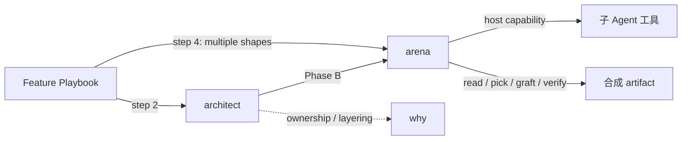

# Dependency Analysis

版本同 [研究首頁](README.md)。本文件的關係來自本機固定版本，不由檔名相似或關鍵字共現推斷。

## 關係語義

| Relation | 定義 | 教材可如何呈現 |
|---|---|---|
| instructs / invokes | 文件明確要求讀取或執行另一 Skill／Playbook | 實線；標 instruction-defined，非 runtime call |
| conditional | 條件成立才使用，例如 motivation question 才 why | 實線附條件，不畫成所有任務的必經路徑 |
| references / recommends | 使用風格、供選擇或建議後續維護 | 虛線，不能當安裝阻斷或必定執行 |
| imports / runs | 可執行程式有 import、process spawn 或明確 helper 入口 | 標 code-enforced；仍不表示本研究已執行 |
| requires host capability | 宿主或外部 plugin／service 提供的工具 | 放外部邊界，例如 Task、GitHub、Cursor Automations |
| transitive | 沿已存在 direct edges 走至少兩步 | 與 direct 分開，保留整條 evidence path |

本文件分析的是**作業與參照關係**，不是 npm install graph。Skill A 提到 Skill B，不表示安裝器會自動把 B 安裝，也不表示每次 A 必定啟動 B。

## 已核對的直接關係

Source 欄指向擁有該關係的文件；章節名稱方便在編輯器搜尋。這是核心關係清單，不宣稱列完全部 prose references。58 個 Skills 與全部檔案已另外完整盤點。

| From | To | Relation／條件 | Evidence |
|---|---|---|---|
| Cursor plugin manifest | skills/、agents/ | discovery paths | [manifest](../../pstack/.cursor-plugin/plugin.json)，`skills`／`agents` keys |
| poteto-mode | 23 Playbooks | instructs，按 request 選擇 | [mode](../../pstack/skills/poteto-mode/SKILL.md)，Playbooks |
| poteto-mode | principle-* | conditional，套用原則時讀 leaf 全文 | [mode](../../pstack/skills/poteto-mode/SKILL.md)，Principles |
| poteto-mode | architect | conditional，code crossing function boundary | [mode](../../pstack/skills/poteto-mode/SKILL.md)，Non-negotiables |
| poteto-mode | swarm／arena | conditional，coverage fan-out／bakeoff | [mode](../../pstack/skills/poteto-mode/SKILL.md)，Non-negotiables |
| poteto-mode | no-comments／unslop／technical-writing | review 前／prose／docs 等各自觸發條件 | [mode](../../pstack/skills/poteto-mode/SKILL.md)，Non-negotiables |
| poteto-mode | show-me-your-work | conditional，長期／unattended／multi-phase | [mode](../../pstack/skills/poteto-mode/SKILL.md)，Non-negotiables |
| poteto-agent | poteto-mode | instructs，工作前完整讀 mode | [agent](../../pstack/agents/poteto-agent.md) |
| architect | arena | invokes，設計 sketch 的 Phase B | [architect](../../pstack/skills/architect/SKILL.md)，Phase B |
| architect | why | conditional，重定 ownership／layering 時探查既有理由 | [architect](../../pstack/skills/architect/SKILL.md)，Phase A |
| architect | interrogate | recommends，實作前需要 adversarial pressure | [architect](../../pstack/skills/architect/SKILL.md)，Phase C |
| architect | references/runner-prompt.md／design-red-flags.md／rationale-template.md | instructs，runner brief／screening／產出格式 | [architect](../../pstack/skills/architect/SKILL.md) |
| arena | 宿主 subagent tool／settings | requires host capability；runners＋條件式 cross-vendor judge | [arena](../../pstack/skills/arena/SKILL.md)，A–C |
| swarm | 宿主 subagent tool／settings | requires host capability；coverage／race workers | [swarm](../../pstack/skills/swarm/SKILL.md)，A–B |
| interrogate | arena | invokes **部分階段** A3／A4／B、F，跳過 C／D／E | [interrogate](../../pstack/skills/interrogate/SKILL.md)，Fan out／Verify |
| interrogate | in-your-own-words | invokes，先確認 intent | [interrogate](../../pstack/skills/interrogate/SKILL.md)，Frame |
| teach | how、why | invokes，runtime 與 rationale 結合；小問題可能只需其一 | [teach](../../pstack/skills/teach/SKILL.md)，steps 1–3 |
| teach | unslop | invokes，輸出清楚說明 | [teach](../../pstack/skills/teach/SKILL.md)，尾段 |
| how | 宿主唯讀 general-purpose subagent | requires host capability，沒有工具則自行依序完成 | [how](../../pstack/skills/how/SKILL.md)，Explain |
| why | history／PR discussions／其他記錄 | requires source evidence；**未要求固定呼叫 how** | [why](../../pstack/skills/why/SKILL.md)，全文 |
| blast-radius | how、why | references，說明角色互補；不可僅由這句推出執行呼叫 | [blast-radius](../../pstack/skills/blast-radius/SKILL.md)，開頭 |
| blast-radius | arena／unslop | 候選反例探索／輸出整理，依 Steps 原文 | [blast-radius](../../pstack/skills/blast-radius/SKILL.md)，Steps／尾段 |
| technical-writing | unslop | invokes，明示 apply 到每個 touched doc | [technical-writing](../../pstack/skills/technical-writing/SKILL.md)，Voice and repo specifics |
| ketchup | bro | references，借 voice，**不是重做 bro 的 task** | [ketchup](../../pstack/skills/ketchup/SKILL.md)，開頭 |
| ketchup-video | ketchup | instructs，Follow ketchup，但以影片取代 summary／visuals；bro 是經 ketchup 才到的間接語氣參照 | [ketchup-video](../../pstack/skills/ketchup-video/SKILL.md)，開頭 |
| no-comments | comment-sicko Agent 或 reference prompt | invokes；非 Cursor 以 general agent＋reference，無子 Agent 則 fresh pass | [no-comments](../../pstack/skills/no-comments/SKILL.md)，step 1 |
| no-comments | architect | conditional，accepted fixes 需要結構時；只到 sketch | [no-comments](../../pstack/skills/no-comments/SKILL.md)，step 3 |
| no-comments | why | conditional，薄弱的約束註解判定需追歷史 | [no-comments](../../pstack/skills/no-comments/SKILL.md)，step 2 |
| reflect | 3 reviewer references＋synthesizer | invokes，三個 lenses 再統整 | [reflect](../../pstack/skills/reflect/SKILL.md)，steps 2–3 |
| reflect | skill-authoring tool | conditional，獲准的實質修改／新 Skill | [reflect](../../pstack/skills/reflect/SKILL.md)，step 5 |
| figure-it-out | architect | conditional，one-way-door design；已定形機械修改略過 | [figure-it-out](../../pstack/skills/figure-it-out/SKILL.md)，Phase B |
| figure-it-out | show-me-your-work | invokes，canonical decision trail | [figure-it-out](../../pstack/skills/figure-it-out/SKILL.md)，Phase D |
| setup-pstack | create-verification-skill／create-formal-verification-skill | recommends offer；使用者 yes 才 invoke | [setup](../../pstack/skills/setup-pstack/SKILL.md)，steps 7–8 |
| create-verification-skill | maintain-verification-skill | recommends，後續 maintenance loop | [create verify](../../pstack/skills/create-verification-skill/SKILL.md)，step 5 |
| create-formal-verification-skill | statechart | conditional，選 TLA+ 時要求生成的 skill 以此讀結果 | [create formal](../../pstack/skills/create-formal-verification-skill/SKILL.md)，Generate the verify skill |
| create-formal-verification-skill | maintain-formal-verification-skill | recommends，hand off 時介紹維護 | [create formal](../../pstack/skills/create-formal-verification-skill/SKILL.md)，Hand off |
| show-me-your-work | log.sh | optional helper，不是唯一追加方法 | [trail skill](../../pstack/skills/show-me-your-work/SKILL.md)，Logging a row |
| show-me-your-work | 宿主 transcript、different-family reviewer | requires host capability，對照 trail／獨立 review | [trail skill](../../pstack/skills/show-me-your-work/SKILL.md)，Audit／Cross-model review |
| recall | session-pickup／automate-me | conditional routing；單個 prior run／捕捉個人習慣 | [recall](../../pstack/skills/recall/SKILL.md)，step 1 |
| automate-me | 外部 skill-authoring tool／unslop | invokes，mining→authoring→prose iteration | [automate-me](../../pstack/skills/automate-me/SKILL.md)，Flow |
| Feature Playbook | architect／poteto-agent／條件式 arena／interrogate | instructs／conditional，依步驟與設計情況 | [feature](../../pstack/skills/poteto-mode/playbooks/feature.md) |
| Bug fix Playbook | why／條件式 architect、tdd／Opening a PR | instructs／conditional | [bug-fix](../../pstack/skills/poteto-mode/playbooks/bug-fix.md) |
| Perf Playbook | benchmark-checklist／條件式 architect | invokes／conditional | [perf](../../pstack/skills/poteto-mode/playbooks/perf-issue.md) |
| Hillclimb | show-me-your-work／benchmark-checklist／Perf mantras | invokes／references 指定部分，而非完整 Perf stop rule | [hillclimb](../../pstack/skills/poteto-mode/playbooks/hillclimb.md) |
| Babysit | watch-pr／Origin CLI | requires tool，**依 forge 二選一** | [babysit](../../pstack/skills/poteto-mode/playbooks/babysit.md)，step 6 |
| Shipping | 獨立 verifier／queued watch-pr 或 Origin watcher | requires host capability／conditional tool | [shipping](../../pstack/skills/poteto-mode/playbooks/shipping.md) |
| Autopilot-stack | Autopilot-full | invokes with overrides：不 merge／允許相依 stack | [stack](../../pstack/skills/poteto-mode/playbooks/autopilot-stack.md) |
| Multi-phase plan | check-plan.mjs | runs，驗證特定計畫模板 | [multi-phase-plan](../../pstack/skills/poteto-mode/playbooks/multi-phase-plan.md)，step 6 |
| Worktree cleanup | worktree-audit.sh | runs，分類建議不是刪除授權 | [cleanup](../../pstack/skills/poteto-mode/playbooks/worktree-cleanup.md)，step 1 |
| Benny setup | project-scoped pstack skills／外部 `/automate` | requires external capability，pack 不註冊成 slash skills | [FOR_AGENTS](../../pstack/automations/benny/FOR_AGENTS.md) |
| Benny triage | why／unslop／principles | invokes，source trace／verdict | [triage](../../pstack/automations/benny/skills/triage-issue-reports/SKILL.md) |
| Benny repro | trusted triage marker／control adapter／feature map | requires contract／external capability；非直接呼叫 triage 的函式 | [repro](../../pstack/automations/benny/skills/reproduce-and-fix-issues/SKILL.md)，§2、§5 |

## 已核對的程式直接關係

| From | To | 行為 | Source |
|---|---|---|---|
| watch-pr executable | bootstrap.ts → cli.ts | ensure deps，dynamic import main | [entry](../../pstack/skills/poteto-mode/scripts/watch-pr/watch-pr) |
| cli.ts | github.ts、policy.ts、render.ts、types.ts | I/O／policy／render 分開；組裝 reader／clock／options | [cli](../../pstack/skills/poteto-mode/scripts/watch-pr/cli.ts) |
| policy.ts | GitHubReader、clock、emit interfaces | 決策透過注入依賴取 snapshots、等候與輸出，不直接承擔外部修正 | [policy](../../pstack/skills/poteto-mode/scripts/watch-pr/policy.ts) |
| github.ts | gh subprocess | 讀 GitHub API／forge checks | [github](../../pstack/skills/poteto-mode/scripts/watch-pr/github.ts) |
| statechart wrapper | statechart.ts → worker.ts | runtime dispatch、啟動隔離 worker、管理暫存／輸出 | [wrapper](../../pstack/skills/statechart/scripts/statechart)、[entry](../../pstack/skills/statechart/scripts/statechart.ts) |
| worker.ts | run.ts／pipeline.ts／view frontend | check→compile→寫 staged outputs | [worker](../../pstack/skills/statechart/scripts/worker.ts) |
| run.ts | mise／Java／TLC、frontends／passes | model checker 執行與讀取 graph／messages／traces | [run](../../pstack/skills/statechart/scripts/run.ts) |
| pipeline.ts | passes／backends／IR | graph walk／label／region checks→report／Mermaid／plain text | [pipeline](../../pstack/skills/statechart/scripts/pipeline.ts) |

這些是核心入口 trace，非所有 TypeScript import 的完整列舉。完整 file inventory 的目的，是讓後續有需要時可以深入到單一 parser／pass，而不是將 569 個檔案全混成 Skill dependencies。

## 直接與間接的具體例子

| 起點／終點 | 類型 | 路徑與條件 |
|---|---|---|
| architect → arena | direct | architect Phase B 明確啟用 arena |
| Feature → arena | 同時存在 direct 與 indirect | direct 是 Feature step 4 的多形狀實作；indirect 是 Feature step 2→architect→arena 的設計探索，兩者不同情境 |
| poteto-mode → arena | direct，也可能有其他間接路徑 | mode Non-negotiables 直接指定 bakeoff 用 arena；也可能路由 Feature→architect→arena，不可只保留最短路徑就抹掉情境 |
| create-formal-verification-skill → TLC | transitive、conditional | 選 TLA+→生成 skill 要求使用 statechart→scripts entry／worker→run.ts→TLC；不是任何 formal verification 都一定用 TLC |
| Benny repro → triage | protocol dependency | 等待外部 triage 寫入可信 marker，不是 module import、不是由 repro 直接執行 triage |
| ketchup → bro | direct reference | 借語氣，原文明示不是 bro 的重述任務；不可畫成必定執行 bro |
| why → how | 未確認實際 invokes edge | mirror README 的安裝表建議一起裝，但本版 why 全文只要求讀 history。安裝建議可以呈現為 recommends，不升格成呼叫 |

## 一張小型依賴圖

此圖只選「設計探索」路徑，為教學抽樣，不是完整全圖；全部節點都是實際元件。

## 外部能力與未提供的元件

- `Task`／Agent 工具、model provisioning、context window 與部分 transcript 管理由宿主提供，不是 pstack scripts 實作。[Harness mappings](../../pstack/skills/poteto-mode/SKILL.md)。
- `deslop`、`control-ui`、`control-cli` 屬 `cursor-team-kit`，本機 pstack 未包含這些 Skill。mode 有缺少時的替代指引，不應把它們列成 bundled pstack Skills。[mode Harness](../../pstack/skills/poteto-mode/SKILL.md)。
- `/loop` 是宿主功能，不是本專案的 Skill／daemon。不同 Playbooks 的監督機制不同，Orchestrate 甚至明確不要 polling loops。[autonomous-run](../../pstack/skills/poteto-mode/playbooks/autonomous-run.md)、[orchestrate](../../pstack/skills/poteto-mode/playbooks/orchestrate.md)。
- Slack／tracker／Cursor Automations 必須另外設定；Benny configuration 的 placeholders 是模板，不是可用 credentials／可執行 integration。[config](../../pstack/automations/benny/templates/configuration.example.yaml)。
- 全域 hooks、中央 workflow DB、通用 event bus、可強制 Markdown 全部規則的 runtime：在本版盤點中未找到。此結論限定這個 checkout，不能推論 Cursor 內部系統也沒有。
